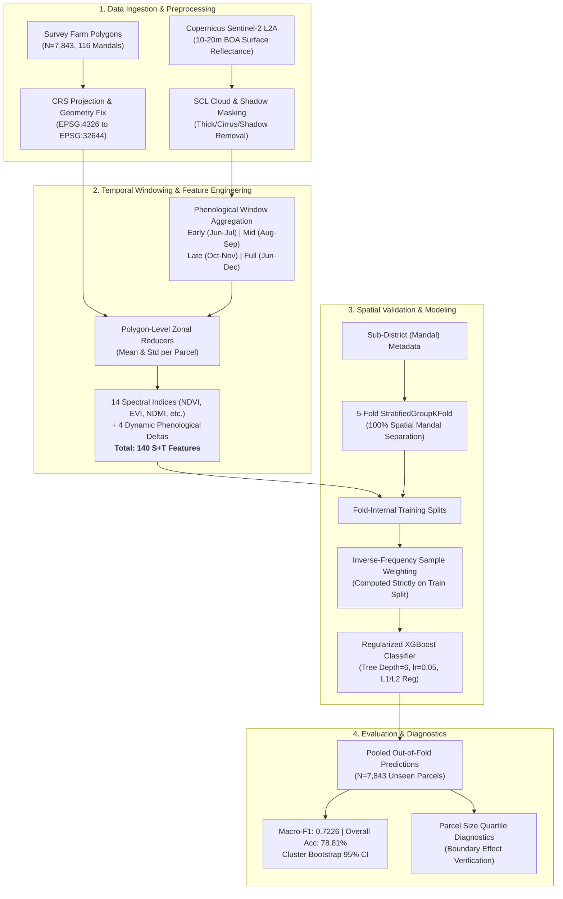

# Publication Figures and Tables Blueprint

**Document Role:** Visual and Tabular Asset Plan for Research Paper Submission  
**Target Venue:** IEEE / Springer / Elsevier Conference on Remote Sensing and Machine Learning  
**Asset Directory:** `outputs/reports/paper_materials/figures/`  
**Data Provenance:** All figures and tables are derived exclusively from verified repository artifacts (Phase 6I model selection audit, Phase 6H boundary ablation, and N=7,843 spatial cross-validation records).  

---

## 1. Inventory of Publication-Quality Figures

| Figure ID | File Name | Title & Caption | Primary Data Source | Key Scientific Takeaway |
| :-: | :--- | :--- | :--- | :--- |
| **Figure 1** | [`fig1_confusion_matrices.png`](file:///c:/Users/Manichander/OneDrive/Desktop/cbit/major%20project/major_proj_final/outputs/reports/paper_materials/figures/fig1_confusion_matrices.png) | **Figure 1:** Out-of-fold confusion matrices for the Primary Model (Weighted S+T, 140 features) vs Secondary Model (Weighted S+T+P, 160 features) across $N = 7,843$ validated farm parcels under 5-fold Mandal spatial cross-validation. | `phase6i_robustness_audit.json` | Shows exceptional classification fidelity for Paddy (87.5%), Groundnut (87.0%), and Bengal Gram (86.7%), while revealing confusion mechanics between Maize and Bengal Gram, and highlighting preservation of minority Red Gram and Chillies. |
| **Figure 2** | [`fig2_class_wise_performance.png`](file:///c:/Users/Manichander/OneDrive/Desktop/cbit/major%20project/major_proj_final/outputs/reports/paper_materials/figures/fig2_class_wise_performance.png) | **Figure 2:** Per-class F1 score comparison between the 140-feature S+T model and the 160-feature S+T+P model across all seven crop classes. | `phase6i_model_selection_report.md` | Demonstrates that the parsimonious S+T model achieves equal or superior F1 on minority crops (Chillies: 0.534 vs 0.522; Red Gram: 0.442 vs 0.432), proving texture features do not benefit minority crops. |
| **Figure 3** | [`fig3_fold_variability.png`](file:///c:/Users/Manichander/OneDrive/Desktop/cbit/major%20project/major_proj_final/outputs/reports/paper_materials/figures/fig3_fold_variability.png) | **Figure 3:** Spatial generalization stability across five geographically disjoint Sub-District validation folds. | `phase6i_robustness_audit.json` | Illustrates low inter-fold variance ($\sigma = \pm 0.0181$), confirming that the model generalizes robustly across diverse agro-climatic zones of Telangana. |
| **Figure 4** | [`fig4_parcel_size_quartiles.png`](file:///c:/Users/Manichander/OneDrive/Desktop/cbit/major%20project/major_proj_final/outputs/reports/paper_materials/figures/fig4_parcel_size_quartiles.png) | **Figure 4:** Model performance across farm parcel area quartiles: Q1 (<1,257 $\text{m}^2$), Q2 (1,257–2,783 $\text{m}^2$), Q3 (2,784–5,517 $\text{m}^2$), and Q4 (>5,528 $\text{m}^2$). | `phase6h_weighting_boundary_report.md` | Provides empirical proof of the **boundary contamination effect**: spatial GLCM texture degrades Macro-F1 by -0.0133 on smallholder farms (Q1) due to kernel edge bleeding, only helping large consolidated holdings (Q3). |
| **Figure 5** | [`fig5_pipeline_evolution.png`](file:///c:/Users/Manichander/OneDrive/Desktop/cbit/major%20project/major_proj_final/outputs/reports/paper_materials/figures/fig5_pipeline_evolution.png) | **Figure 5:** Stepwise Macro-F1 progression across research phases, from pilot satellite baseline (0.5511, $N=714$) to scale-up early season (0.5058, $N=7,843$), full season (0.6174, $N=7,843$), multi-temporal S+T (0.7069, $N=7,843$), and inverse-weighted S+T (0.7226, $N=7,843$). | Benchmark reports (Phases 6D, 6F, 6I) | Demonstrates the quantitative impact of each engineering phase: +11.16 pp from phenological maturity, +8.95 pp from 4-window temporal trajectory engineering, and +1.57 pp from fold-internal inverse-frequency weighting, with explicit annotation of the 11× cohort expansion ($N=714 \to 7,843$). |

---

## 2. Recommended System Architecture & Workflow Diagrams (Mermaid)

### Figure 6: End-to-End System Architecture Diagram

---

## 3. Recommended Publication Tables

### Table 1: Dataset Composition and Agro-Ecological Profiles
- **Columns:** Crop Species, Botanical Name, Class Type, Growth Duration, Sample Count ($N$), Percentage (%), Median Parcel Area ($\text{m}^2$).
- **Data Source:** `datasss/Train.csv` and `geometry_validation_report.txt`.
- **Purpose:** Establishes the real-world smallholder context and severe class imbalance (Paddy: 28.8% vs Red Gram: 2.8%).

### Table 2: Mathematical Definitions of 14 Spectral Indices
- **Columns:** Index Name, Abbreviation, Mathematical Formula, Spectral Bands Used, Biophysical Significance.
- **Data Source:** `outputs/reports/paper_materials/methodology.md`.
- **Purpose:** Complete scientific reproducibility for remote sensing peer reviewers.

### Table 3: Master Performance Comparison Matrix
- **Columns:** Model Name, Features ($D$), Sample Weighting, Spatial CV Scheme, Macro-F1, Balanced Accuracy, Overall Accuracy, Weighted-F1, Runtime per Fold.
- **Data Source:** `phase6i_robustness_audit.json`.
- **Purpose:** Primary experimental results table proving statistical parity between 140 S+T (0.7226) and 160 S+T+P (0.7228).

### Table 4: Class-Wise Performance Metrics (Primary vs Secondary Model)
- **Columns:** Crop Class, True Support ($N$), Weighted S+T (Precision, Recall, F1), Weighted S+T+P (Precision, Recall, F1), F1 Difference ($\Delta$).
- **Data Source:** `phase6i_model_selection_report.md`.
- **Purpose:** Proves that the parsimonious model protects minority classes (Red Gram +0.0103 higher F1 in S+T).

### Table 5: Boundary Contamination Ablation across Area Quartiles
- **Columns:** Quartile, Area Range ($\text{m}^2$), Parcel Count ($N$), Median Area, S+T Macro-F1, S+T+P Macro-F1, Delta ($\Delta$), Observed Boundary Artifact.
- **Data Source:** `phase6h_weighting_boundary_report.md`.
- **Purpose:** Core scientific defense explaining why spatial texture features fail in smallholder landscapes.

### Table 6: Cross-Validation Fold Partitioning and Group Independence
- **Columns:** Fold Index, Training Mandals ($N$), Validation Mandals ($N$), Validation Parcels ($N$), Out-of-Fold Macro-F1, Out-of-Fold Accuracy.
- **Data Source:** `phase6f_cv_folds_audit.json` and `phase6i_robustness_audit.json`.
- **Purpose:** Documents zero geographic overlap and spatial stability across all five folds.
