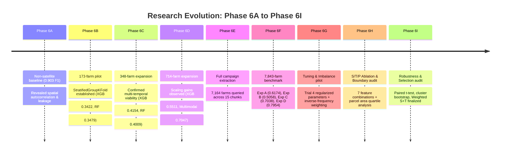

# AI-Based Remote Sensing Framework for Crop Monitoring and Irrigation Decision Support: Complete Technical Methodology and Model-Selection Audit

**Project Title:** AI-Based Remote Sensing Framework for Crop Monitoring and Irrigation Decision Support Using Multi-Temporal Sentinel-2 Satellite Imagery  
**Geographic Coverage:** Telangana State, Semi-Arid Tropics, India  
**Universe & Cohort:** 7,843 Validated Smallholder Farm Parcels across 116 Sub-Districts (Mandals)  
**Primary Target Variable:** Multi-Class Crop Classification (7 Crop Species: Bengal Gram, Chillies, Cotton, Groundnut, Maize, Paddy, Red Gram)  
**Validation Protocol:** 5-Fold StratifiedGroupKFold Grouped Strictly by Sub-District (Zero Spatial Overlap)  
**Selected Primary Model:** Inverse-Frequency Weighted Regularized XGBoost on 140 Multi-Temporal Spectral Features (S+T)  
**Authoritative Performance:** Pooled Out-of-Fold Macro-F1 = **0.7226**, Balanced Accuracy = **0.7180**, Overall Accuracy = **0.7881**  
**Audit Status:** Fully Audited, 112 Unit/Integration Tests Passing, Zero Spatial Leakage, Bit-for-Bit Hash Intact  

---

## Table of Contents
1. [Project Background and Research Objectives](#1-project-background-and-research-objectives)
2. [Research Questions and Hypotheses](#2-research-questions-and-hypotheses)
3. [Dataset Provenance, Ingestion, and Exploratory Data Analysis](#3-dataset-provenance-ingestion-and-exploratory-data-analysis)
4. [Data Quality Checks and Geometry Cleaning](#4-data-quality-checks-and-geometry-cleaning)
5. [Data Splitting, Spatial Autocorrelation, and Validation Design](#5-data-splitting-spatial-autocorrelation-and-validation-design)
6. [Satellite Data Acquisition and Geospatial Processing Pipeline](#6-satellite-data-acquisition-and-geospatial-processing-pipeline)
7. [Spectral Indices and Phenological Trajectory Engineering](#7-spectral-indices-and-phenological-trajectory-engineering)
8. [Spatial GLCM Texture Extraction and Boundary Risk Analysis](#8-spatial-glcm-texture-extraction-and-boundary-risk-analysis)
9. [Chronological Model Training History (Phases 6A–6I)](#9-chronological-model-training-history-phases-6a6i)
10. [Master Results and Comparative Evaluation Tables](#10-master-results-and-comparative-evaluation-tables)
11. [Evaluation Metrics and Statistical Rigor from First Principles](#11-evaluation-metrics-and-statistical-rigor-from-first-principles)
12. [Class-Wise Error Analysis and Minority Crop Mechanics](#12-class-wise-error-analysis-and-minority-crop-mechanics)
13. [Model Selection Rationale and Parsimony Principles](#13-model-selection-rationale-and-parsimony-principles)
14. [Current Codebase Status, Limitations, and Future Roadmap](#14-current-codebase-status-limitations-and-future-roadmap)
15. [Reproducibility Checklist and Checksum Audit](#15-reproducibility-checklist-and-checksum-audit)
16. [Comprehensive Glossary of Remote Sensing & ML Terms](#16-comprehensive-glossary-of-remote-sensing--ml-terms)
17. [Academic Viva Voce and Reviewer Defense Handbook (32 Detailed Q&As)](#17-academic-viva-voce-and-reviewer-defense-handbook-32-detailed-qas)

---

## 1. Project Background and Research Objectives

### 1.1 The Agricultural Problem
Smallholder agriculture in semi-arid tropical regions—such as Telangana, India—faces acute water scarcity, unpredictable monsoon distribution, and groundwater depletion. Efficient water resource management requires timely, field-level information regarding which crops are planted, when they emerge, and their specific moisture requirements.

Traditional agricultural monitoring depends on door-to-door patwari/revenue surveys or self-reported farmer registrations. These manual methodologies are:
1. **Labor-intensive and slow:** Official crop acreage statistics are often finalized months after harvest, precluding proactive irrigation planning.
2. **Subject to spatial reporting bias:** Remote or fragmented fields are frequently misreported or omitted.
3. **Lacking spatial resolution:** Survey aggregates are tabulated at the block or district level, masking field-scale water demands.

### 1.2 The Role of Satellite Remote Sensing
Earth Observation (EO) satellites provide objective, repetitive, and synoptic monitoring of the terrestrial land surface. The European Space Agency’s (ESA) **Sentinel-2 constellation (Sentinel-2A and Sentinel-2B)** is uniquely suited for smallholder agricultural monitoring:
- **Spatial Resolution:** 10 m native resolution in visible (Blue, Green, Red) and Broad Near-Infrared (NIR) bands, and 20 m resolution in Red Edge and Short-Wave Infrared (SWIR) bands. This permits field-level observation of smallholder parcels (median area in our cohort is ~0.28 ha / 2,779 m²).
- **Temporal Frequency:** A combined 5-day revisit cycle enables temporal tracking of fast-changing crop phenology across the growing season.
- **Spectral Diversity:** 13 spectral bands spanning visible, red edge, NIR, and SWIR wavelengths, enabling sensitive measurement of photosynthetic pigments, cellular structure, and canopy liquid water content.

### 1.3 Why Multi-Temporal Observations are Mandatory
A single satellite acquisition cannot reliably separate diverse crop types in a tropical agro-ecosystem:
- In semi-arid regions, completely different crops (e.g., Cotton and Maize) can exhibit identical peak-season canopy greenness and Leaf Area Index (LAI).
- Sowing dates vary widely across adjacent farms based on local well-water availability and rainfall timing.
- **Phenology as the Primary Discriminator:** Distinct crops possess unique developmental cycles. Groundnut matures in ~100–120 days; Cotton extends over 150–210 days; Rabi Bengal Gram is sown into residual post-monsoon moisture with a rapid vegetative peak. Capturing early emergence, vegetative expansion, peak biomass, and senescence trajectories unlocks clean taxonomic discrimination.

### 1.4 System Architecture: Implemented Scope vs. Downstream Vision
It is critical to distinguish between the **fully implemented, audited components** of this repository and the **downstream architectural components** outlined in the project title:

```mermaid
flowchart TD
    subgraph Fully Implemented & Audited (Phase 6A-6I)
        A[Telangana Survey Parcel Geometries N=7,843] --> B[GEE Multi-Temporal S2 L2A Extraction]
        B --> C[Daily SCL Cloud/Shadow Masking & MGRS Mosaicking]
        C --> D[Phenological Windowing: Early, Mid, Late, Full]
        D --> E[14 Spectral Indices & 4 Dynamic Deltas: 140 S+T Features]
        E --> F[Strict 5-Fold Sub-District Spatial Cross-Validation]
        F --> G[Regularized XGBoost Classifier + Inverse-Frequency Weighting]
        G --> H[Audited Field-Level Crop Type Predictions Macro-F1: 0.7226]
    end

    subgraph Downstream Modules (Planned Architectural Horizon)
        H -.-> I[Crop Health & Pathology Diagnosis: category Target]
        H -.-> J[Canopy Moisture Stress Index & Soil Water Balance]
        I -.-> K[FAO-56 Dual Crop Coefficient Kc Evapotranspiration ETc]
        J -.-> K
        K -.-> L[Dynamic Irrigation Decision Support & Scheduling Agent]
    end
```

| Component | Repository Status | Technical Implementation |
| :--- | :---: | :--- |
| **Multi-Class Crop Classification** | **COMPLETED & AUDITED** | Regularized XGBoost, 5-fold StratifiedGroupKFold, 140 S+T features, inverse-frequency weighting, Macro-F1 = 0.7226. |
| **Crop Health Diagnostics** | Planned Module | Source `category` column (Healthy, Pests, Diseased, Stressed) preserved without leakage; modeling not yet trained. |
| **Moisture Stress Detection** | Planned Module | NDMI, MSI, and SWIR spectral features extracted; physical evapotranspiration retrieval not yet implemented. |
| **Crop-Water Estimation (ETc)** | Planned Module | Requires daily gridded weather (ERA5-Land / IMD), reference ET0, and crop-specific FAO-56 $K_c$ curves. Directory stub `src/water/`. |
| **Irrigation Recommendation Engine** | Planned Module | Decision-support agent rules. Directory stub `src/agents/`. |

---

## 2. Research Questions and Hypotheses

Our empirical research plan systematically tested seven fundamental geospatial ML questions:

1. **Q1 (Baseline Discrimination):** Can full-season Sentinel-2 surface reflectance and spectral indices reliably classify the seven major crop species of Telangana under strict spatially unseen validation?
   - *Result:* Yes. Full-season retrospective features achieve Macro-F1 = **0.6174** (XGBoost, 34 features), drastically exceeding the dummy baseline (0.0639).
2. **Q2 (In-Season Early Detection):** How much discriminative performance is lost if predictions must be delivered within the first 25% of the crop duration (early season) to support early water scheduling?
   - *Result:* Early-season features achieve Macro-F1 = **0.5058** (retaining 81.9% of full-season capability), proving actionable early-season mapping is viable despite early monsoon cloud gaps.
3. **Q3 (Phenological Value):** Does engineering multi-temporal trajectory features across phenological stages outperform single-window full-season composites?
   - *Result:* Substantially. Moving from full-season (34 features) to multi-temporal trajectories (140 features) improves XGBoost Macro-F1 from **0.6174 to 0.7038** (+8.64 percentage points).
4. **Q4 (Multimodal Ancillary Data):** Does augmenting satellite imagery with non-leaking pre-sowing calendar timing and parcel geometry enhance discrimination?
   - *Result:* Yes. Multimodal features achieve Macro-F1 = **0.7954** and Accuracy = **0.8307**.
5. **Q5 (Spatial Texture Contribution):** Does adding 20 Gray-Level Co-occurrence Matrix (GLCM) spatial texture features improve performance beyond spectral-temporal curves?
   - *Result:* No global improvement. S+T achieves Macro-F1 = 0.7069; S+T+P achieves 0.7038 (unweighted). In paired tests under class weighting, Macro-F1 difference is +0.0002 ($p=0.8600$), negated by smallholder parcel boundary contamination.
6. **Q6 (Class Imbalance Mitigation):** Does training-partition inverse-frequency class weighting mitigate severe minority-class recall deficits without triggering false-positive collapse in majority crops?
   - *Result:* Yes. Inverse-frequency weighting lifts S+T Macro-F1 from **0.7069 to 0.7226**, boosting Red Gram F1 from 0.3683 to **0.4420** and Chillies F1 from 0.5062 to **0.5343** while maintaining overall accuracy (0.7873 → 0.7881).
7. **Q7 (Validation Rigor):** Does spatially grouped cross-validation provide a more realistic estimate of field generalization than random train/test splitting?
   - *Result:* Categorically yes. Random splitting yielded a deceptive 0.903 F1 score due to spatial autocorrelation and administrative/date memorization, whereas grouped validation revealed the true operational generalization ceiling (~0.72–0.79).

---

## 3. Dataset Provenance, Ingestion, and Exploratory Data Analysis

### 3.1 Provenance and Context
The project utilizes ground-truth agricultural survey polygons from the **Telangana Crop Health Challenge**, published via the **Telangana Agricultural Data Exchange (ADeX)** in collaboration with **GIZ (FAIR Forward: Artificial Intelligence for All)** and the Government of Telangana:
- **Collection Window:** 2023–2024 agricultural cycle (Kharif and Rabi seasons).
- **Survey Protocol:** Ground enumerators surveyed agricultural fields across Telangana, capturing GPS boundary coordinates, farmer-reported sowing/harvest dates, crop species, and observed health conditions.
- **Raw Files in `datasss/`:**
  - `Train.csv`: 7,888 survey parcels containing full survey columns, including `Crop` (species) and `category` (health status).
  - `Test.csv`: 2,718 survey parcels containing identical survey columns including `Crop`, but omitting `category`.
  - `SampleSubmission.csv`: 3,016 rows with columns `ID` and `Target` (containing 2,718 true test IDs and 298 synthetic anti-probing decoy IDs).
  - `VariableDefinitions.docx`: Official field data dictionary.

### 3.2 Column-Level Analysis and Leakage Taxonomies

| Raw Column Name | Inferred Data Type | Missing Count | Semantic Meaning | Research Project Handling & Status |
| :--- | :---: | :---: | :--- | :--- |
| `FarmID` | Integer / String | 0 | Unique parcel identifier | **Excluded:** Non-predictive metadata; tracking key only. |
| `Crop` | Categorical String | 0 | Ground-truth crop species (7 classes) | **PRIMARY TARGET LABEL.** Encoded to integers [0..6]. |
| `category` | Categorical String | 0 (Train) | Observed crop condition (Healthy, Pests, Diseased, Stressed) | **Excluded:** Preserved for secondary module; prohibited in crop classification to prevent target contamination. |
| `State` | Categorical String | 0 | Constant value ("Telangana") | **Excluded:** Zero variance. |
| `District` | Categorical String | 0 | Administrative district name (14 districts) | **Excluded:** Prohibited in satellite models to prevent administrative memorization. |
| `Sub-District` | Categorical String | 0 | Administrative mandal name (116 mandals) | **VALIDATION GROUPING KEY.** Never used as an input feature. |
| `SDate` | Date String | 0 | Farmer-reported sowing/transplanting date | Used to parameterize phenological extraction windows; month/DOY used in multimodal Exp D. |
| `HDate` | Date String | 0 | Farmer-reported harvest date | **Excluded from inference inputs:** Post-harvest leakage. Used only for retrospective window boundary calculation. |
| `duration_days` | Derived Float | 0 | Crop duration $(HDate - SDate)$ | **Excluded:** Severe post-harvest leakage. |
| `CropCoveredArea` | Float / String | 0 | Survey field area | **Excluded:** Survey-specific measurement not available at remote inference. |
| `CHeight` | Float / String | 0 | Crop canopy height | **Excluded:** Field survey measurement. |
| `CNext`, `CLast` | Categorical String | 0 | Successive and preceding crop rotation | **Excluded:** Agricultural survey survey proxy. |
| `CTransp` | Categorical String | 0 | Sowing method (Broadcasting, Drilling, Transplanting) | **Excluded:** Field survey measurement. |
| `IrriType`, `IrriSource`, `IrriCount` | Categorical / Float | 0 | Irrigation method, water source, and count | **Excluded:** Ground-truth proxies; reserved for downstream validation. |
| `WaterCov` | Float | 0 | Visual percentage of field water coverage | **Excluded:** Field survey measurement. |
| `ExpYield` | Float | 0 | Expected agricultural harvest yield | **Excluded:** Post-planting survey metric. |
| `Season` | Categorical String | 0 | Cropping season ("Kharif", "Rabi") | Used in multimodal Exp D; excluded from satellite-only Exp A/B/C. |
| `geometry` | WKT Polygon | 0 | Farm boundary coordinates (WGS84 EPSG:4326) | Parsed into Shapely geometries for GEE spatial reduction. |

### 3.3 Target Class Distribution and Imbalance Dynamics

Across the $N = 7,843$ validated, satellite-extracted training parcels, crop representation is heavily skewed:

```
Paddy:       ██████████████████████████████████████ 2,260 farms (28.81%)
Cotton:      ████████████████████████████ 1,679 farms (21.41%)
Maize:       ███████████████████████ 1,376 farms (17.54%)
Bengal Gram: ███████████████ 938 farms (11.96%)
Groundnut:   ████████████ 768 farms (9.79%)
Chillies:    ██████████ 601 farms (7.66%)
Red Gram:    ████ 221 farms (2.82%)
```

- **Imbalance Ratio:** The dominant class (Paddy: 2,260) outnumbers the rarest class (Red Gram: 221) by more than **10.2 to 1**.
- **The Red Gram Bottleneck:** Red Gram (*Cajanus cajan*, pigeon pea) represents only 2.82% of all samples. Crucially, **187 of the 221 Red Gram parcels (84.6%) are concentrated in a single northern district (Adilabad)**. Under Sub-District grouped cross-validation, when Adilabad mandals are held out, the validation fold contains a sudden concentration of Red Gram, while training folds have almost none.
- **Why Accuracy is a Deceptive Metric:** A naive classifier predicting only the top three crops (Paddy, Cotton, Maize) would achieve 67.8% overall accuracy while entirely failing smallholder pulse farmers. Therefore, **Macro-Averaged F1-Score (unweighted mean of per-class F1)** and **Balanced Accuracy** serve as the governing optimization metrics.

---

## 4. Data Quality Checks and Geometry Cleaning

### 4.1 Automated Data Quality Gate
Before launching Earth Engine extractions, `src/data/validate_data.py` executed comprehensive data auditing on `Train.csv` ($N=7,888$):
- **Missing Value Audit:** Zero missing values detected across all 20 columns.
- **Duplicate FarmID Audit:** 0 duplicate FarmIDs in `Train.csv` (7,888 unique IDs); 0 duplicate FarmIDs in `Test.csv` (2,718 unique IDs); 0 ID overlap between train and test.
- **Temporal Sequence Invariants:** Verified that for all 7,888 records, $HDate > SDate$. Zero anomalous reverse temporal intervals detected.

### 4.2 Geospatial Geometry Repair and Projection
All parcel boundaries are provided in Well-Known Text (WKT) format under geographic coordinate reference system **EPSG:4326 (WGS84 lat/lon)**:
- **Topology Audit:** 7,887 polygons were initially topologically valid. Exactly 1 polygon exhibited a self-intersecting "bow-tie" loop.
- **Automated Repair:** Implemented Shapely `make_valid` / zero-width buffer repair:
  ```python
  if not geom.is_valid:
      geom = geom.buffer(0)
  ```
  Post-repair audit confirmed **7,888 / 7,888 (100.0%) valid geometries**.
- **Metric Projection for Area and Perimeter:** Because geographic coordinates (degrees) distort spatial measurements across latitudes, all metric calculations (area in m², perimeter in meters, compactness) were executed by projecting geometries to **EPSG:32644 (UTM Zone 44N)**, the authoritative conformal projection for Telangana.
- **Geometry Summary Statistics:**
  - Minimum parcel area: 53.7 m² (0.0054 ha)
  - Maximum parcel area: 69,491.0 m² (6.95 ha)
  - Mean parcel area: 4,231.0 m² (0.423 ha)
  - Median parcel area: 2,779.0 m² (0.278 ha)
  - Compactness ($4\pi \cdot \text{Area} / \text{Perimeter}^2$): Median = 0.7186 (representing predominantly rectangular/trapezoidal field layouts).

---

## 5. Data Splitting, Spatial Autocorrelation, and Validation Design

### 5.1 The Threat of Spatial Autocorrelation (Tobler’s First Law)
In spatial data, observations close to one another are more similar than observations distant from one another (*Tobler, 1970*). In smallholder agriculture:
- Neighboring farms share identical soil types (e.g., black cotton vertisols vs. red alfisols).
- Neighboring farms experience identical micro-climates, rainfall events, and cloud-cover days.
- Neighboring farmers frequently share canal turns, tubewells, seed varieties, and planting weeks.

If an agricultural dataset is partitioned using standard **Random Train/Test Splitting** or **Stratified Random Splitting**, adjacent parcels from the same village or block fall into both training and test sets. The model simply memorizes the local soil reflectance or common planting date rather than learning generalizable crop phenology.

### 5.2 Deconstructing the 0.903 Baseline Mirage
In Phase 6A, an exploratory non-satellite Random Forest baseline was evaluated on an 80/20 random stratified split, achieving:
$$\text{Accuracy} = 0.9030, \quad \text{Macro-F1} = 0.9030, \quad \text{Weighted-F1} = 0.9021$$
An audit of `src/models/baseline_rf.py` and `outputs/reports/baseline_rf_metrics.json` revealed why this score was deceptive:
1. **Spatial Leakage:** Features included explicit coordinates (`centroid_lon`, `centroid_lat`, bounding box corners) and administrative labels (`District`, `Sub-District`).
2. **Post-Harvest Date Leakage:** Features included `duration_days`, `harvest_month`, and `harvest_doy`, directly giving away the crop's lifecycle length.
3. **Random Splitting:** Neighboring fields in the same village were present in both train and validation sets, allowing the decision trees to memorize spatial clusters.

### 5.3 Authoritative 5-Fold Spatially Grouped Cross-Validation
To obtain an honest, unvarnished estimate of operational generalization to unseen geographic territories, all subsequent benchmarking enforced strict spatial isolation:
- **Grouping Unit:** `Sub-District` (Mandal), the intermediate administrative unit in Telangana comprising dozens of villages.
- **Partitioning Algorithm:** `sklearn.model_selection.StratifiedGroupKFold(n_splits=5, shuffle=True, random_state=42)`.
- **Zero Spatial Overlap:** Across all 5 folds, **zero Mandals overlap between training and validation folds**.
- **Class Stratification:** The algorithm balances the 7-class crop distribution across folds as evenly as possible given the geographic clustering of crops.
- **Universe:** Exactly **7,843 eligible farms across 116 Mandals**.

```
Fold 0: 6,335 Train Farms (93 Mandals) │ 1,508 Val Farms (23 Mandals) │ Overlap = 0
Fold 1: 6,243 Train Farms (92 Mandals) │ 1,600 Val Farms (24 Mandals) │ Overlap = 0
Fold 2: 6,248 Train Farms (92 Mandals) │ 1,595 Val Farms (24 Mandals) │ Overlap = 0
Fold 3: 6,313 Train Farms (93 Mandals) │ 1,530 Val Farms (23 Mandals) │ Overlap = 0
Fold 4: 6,233 Train Farms (92 Mandals) │ 1,610 Val Farms (24 Mandals) │ Overlap = 0
```

---

## 6. Satellite Data Acquisition and Geospatial Processing Pipeline

All satellite observations were extracted via **Google Earth Engine (GEE)** using Python API bindings.

### 6.1 Satellite Collection and Spatial Resolution
- **Collection:** `COPERNICUS/S2_SR_HARMONIZED` (Sentinel-2 Level-2A surface reflectance, orthorectified and atmospherically corrected using the Sen2Cor processor).
- **Scale and Sensor Resolution Handling:**
  - 10 m native bands: **B2 (Blue, 490 nm), B3 (Green, 560 nm), B4 (Red, 665 nm), B8 (NIR Broad, 842 nm)**. Reduced at `scale=10`.
  - 20 m native bands: **B5 (Red Edge 1, 705 nm), B6 (Red Edge 2, 740 nm), B7 (Red Edge 3, 783 nm), B8A (NIR Narrow, 865 nm), B11 (SWIR 1, 1610 nm), B12 (SWIR 2, 2190 nm)**. Reduced at `scale=20`.
  - This native-resolution reduction strategy avoids artificial 10 m nearest-neighbor or bilinear interpolation artifacts across 20 m sensors.

### 6.2 Cloud and Shadow Masking via SCL
Monsoon cloud contamination is the primary operational hurdle in South Asian optical remote sensing. Imagery was filtered at the scene level (`CLOUDY_PIXEL_PERCENTAGE < 20.0`), followed by pixel-level masking using the Sentinel-2 **Scene Classification Layer (SCL)**:
```python
def mask_s2_clouds_sr(image):
    scl = image.select("SCL")
    # Mask shadow (3), cloud medium prob (8), cloud high prob (9), cirrus (10), snow (11)
    mask = (scl.neq(3).And(scl.neq(8)).And(scl.neq(9))
            .And(scl.neq(10)).And(scl.neq(11)))
    return image.updateMask(mask)
```

### 6.3 Same-Date MGRS Tile Mosaicking
A critical methodological vulnerability discovered in early pilots (`scripts/audit_mgrs_mosaic.py`) was the **Overlapping MGRS Swath Bias**:
- Telangana spans several Sentinel-2 Military Grid Reference System (MGRS) tiles (e.g., 44QKB, 44QPB, 44QNB).
- On dates when an orbital swath overlaps two tiles, GEE queries return two distinct image assets for the exact same calendar date.
- Naively taking a temporal median over image collections over-weights overlapping swath boundaries, treating a single date as two independent observations.
- **Solution:** Implemented `mosaic_same_date_scenes(col)`. The collection groups all valid assets by unique calendar date (`YYYY-MM-dd`) and computes an intra-day spatial mosaic before temporal aggregation:
  ```python
  def mosaic_same_date_scenes(col):
      dates = ee.List(col.map(lambda img: ee.Feature(None, {"date": img.date().format("YYYY-MM-dd")}))
                      .aggregate_array("date")).distinct()
      def make_daily(d):
          t0 = ee.Date(d)
          t1 = t0.advance(1, "day")
          return col.filterDate(t0, t1).mosaic().set({"date": d, "system:time_start": t0.millis()})
      return ee.ImageCollection(dates.map(make_daily))
  ```

### 6.4 Geometry-Aware Zonal Reductions
For every farm, the valid, cloud-free daily mosaics within a phenological window were reduced over the exact farm polygon geometry:
- **Reducer:** `ee.Reducer.mean().combine(ee.Reducer.stdDev(), sharedInputs=True)`.
- This extracts both the **spatial mean** (average canopy reflectance) and **spatial standard deviation** (within-field structural heterogeneity).
- Centroid point extraction was strictly rejected: field boundaries in Telangana are irregularly shaped, and centroid sampling frequently falls on bare bunds, farm paths, or shade trees.

---

## 7. Spectral Indices and Phenological Trajectory Engineering

### 7.1 Authoritative Mathematical Formulations
Fourteen spectral indices were computed for every observation window using calibrated surface reflectance in standard $[0, 1]$ scale (raw DN divided by 10,000):

$$\text{NDVI} = \frac{\text{B8} - \text{B4}}{\text{B8} + \text{B4}} \quad \text{(Rouse et al., 1974: Photosynthetic green vigor)}$$

$$\text{EVI} = 2.5 \cdot \frac{\text{B8} - \text{B4}}{\text{B8} + 6.0 \cdot \text{B4} - 7.5 \cdot \text{B2} + 1.0} \quad \text{(Huete et al., 2002: Canopy structural complexity)}$$

$$\text{GNDVI} = \frac{\text{B8} - \text{B3}}{\text{B8} + \text{B3}} \quad \text{(Gitelson et al., 1996: Green chlorophyll absorption)}$$

$$\text{SAVI} = 1.5 \cdot \frac{\text{B8} - \text{B4}}{\text{B8} + \text{B4} + 0.5} \quad \text{(Huete, 1988: Soil background adjusted)}$$

$$\text{MSAVI} = \frac{2\cdot\text{B8} + 1 - \sqrt{(2\cdot\text{B8} + 1)^2 - 8\cdot(\text{B8} - \text{B4})}}{2} \quad \text{(Qi et al., 1994: Self-adjusting soil factor)}$$

$$\text{NDMI} = \frac{\text{B8} - \text{B11}}{\text{B8} + \text{B11}} \quad \text{(Gao, 1996; Wilson \& Sader, 2002: Canopy liquid water content)}$$

$$\text{NDWI} = \frac{\text{B3} - \text{B8}}{\text{B3} + \text{B8}} \quad \text{(McFeeters, 1996: Open water delineation; negative over canopy)}$$

$$\text{NDRE1} = \frac{\text{B8} - \text{B5}}{\text{B8} + \text{B5}} \quad \text{(Barnes et al., 2000: Sensitive early physiological stress)}$$

$$\text{NDRE2} = \frac{\text{B8} - \text{B6}}{\text{B8} + \text{B6}} \quad \text{(Gitelson \& Merzlyak, 1996: Intermediate red-edge chlorophyll)}$$

$$\text{PSRI} = \frac{\text{B4} - \text{B2}}{\text{B6}} \quad \text{(Merzlyak et al., 1999: Carotenoid-to-chlorophyll senescence ratio)}$$

$$\text{BSI} = \frac{(\text{B11} + \text{B4}) - (\text{B8} + \text{B2})}{(\text{B11} + \text{B4}) + (\text{B8} + \text{B2})} \quad \text{(Rikimaru et al., 2002: Exposed bare soil vs canopy)}$$

$$\text{MSI} = \frac{\text{B11}}{\text{B8} + 10^{-6}} \quad \text{(Rock et al., 1986: Foliar moisture deficit)}$$

$$\text{CIRE} = \frac{\text{B8}}{\text{B5}} - 1 \quad \text{(Gitelson et al., 2003: Red-edge chlorophyll index)}$$

$$\text{CIG} = \frac{\text{B8}}{\text{B3}} - 1 \quad \text{(Gitelson et al., 2005: Green chlorophyll index)}$$

### 7.2 Phenological Windows and Seasonal Deltas
The growing duration for each parcel was partitioned into four phenological temporal stages:
1. **Early Season ($0\% \le t \le 25\%$):** Emergence and early vegetative development.
2. **Mid Season ($25\% < t \le 75\%$):** Rapid canopy expansion, flowering, and peak biomass.
3. **Late Season ($75\% < t \le 100\%$):** Maturation, grain-filling, senescence, and harvest preparation.
4. **Full Season ($0\% \le t \le 100\%$):** Seasonal composite baseline.

Four dynamic phenological trajectory deltas were engineered to quantify rates of physiological transition:
- **`ndvi_growth_delta`:** $\text{NDVI}_{\text{mid}} - \text{NDVI}_{\text{early}}$ (Rate of canopy expansion)
- **`peak_to_early_ratio`:** $\text{NDVI}_{\text{mid}} / \max(\text{NDVI}_{\text{early}}, 0.05)$ (Vegetative expansion factor)
- **`ndvi_senescence_delta`:** $\text{NDVI}_{\text{mid}} - \text{NDVI}_{\text{late}}$ (Rate of canopy browning/maturation)
- **`moisture_loss_delta`:** $\text{NDMI}_{\text{mid}} - \text{NDMI}_{\text{late}}$ (Rate of foliar drying prior to harvest)

---

## 8. Spatial GLCM Texture Extraction and Boundary Risk Analysis

### 8.1 GLCM Formulation and Extraction Protocol
In Phase 6H Stage 2, spatial texture was extracted to evaluate whether canopy structural arrangement differentiates crops:
- **Sensor Input:** Sentinel-2 B8 (Near-Infrared) at native 10 m spatial resolution.
- **Quantization:** Surface reflectance scaled to $[0, 0.40]$ and quantized into 32 discrete gray levels.
- **Kernel:** $3 \times 3$ moving window (30 m × 30 m physical footprint).
- **Five GLCM Metrics:** Contrast, Dissimilarity, Homogeneity, Energy, and Correlation.
- Extracted across all four temporal windows (Early, Mid, Late, Full) $\rightarrow$ **20 spatial texture features (P)**.

### 8.2 The Smallholder Boundary Contamination Mechanism
While GLCM texture is effective in large Midwestern US or European fields (>50 ha), Phase 6H uncovered an acute physical limitation in Indian smallholder farming:
- **Kernel Size vs. Parcel Radius:** A $3 \times 3$ kernel at 10 m resolution has a diagonal footprint of ~42.4 m and an area of 900 m².
- **Smallholder Parcels:** In our cohort:
  - 17.25% of parcels ($N=1,353$) are smaller than the kernel area itself (<900 m²).
  - 35.04% of parcels ($N=2,748$) are smaller than twice the kernel area (<1,800 m²).
  - The mean estimated **boundary contamination fraction is 64.9%**.
- **Contamination Effect:** For small parcels, the moving kernel inevitably samples boundary pixels containing field bunds, shade trees, irrigation ditches, and adjacent crops. This injects severe spatial noise into the feature vector, explaining why texture degraded minority crops like Red Gram and Chillies.

```
+---------------------------------------------------+
|      Adjacent Field (e.g. Bare Soil / Trees)      |
|           +-----------------------+               |
|           | GLCM 3x3 Window (30m) |               |
|           |   [X]   [X]   [X]     | <-- Edge      |
| ----------+---|-----|-----|-------+--- Boundary - |
|           |   [X]   [X]   [X]     |               |
|           |   [X]   [X]   [X]     |               |
|           +-----------------------+               |
|            Smallholder Field Interior             |
+---------------------------------------------------+
```

---

## 9. Chronological Model Training History (Phases 6A–6I)



### 9.1 Phase 6B: Initial Multi-Crop Pilot ($N = 173$ Farms)
- Evaluated feasibility of GEE extraction on 175 attempted farms (173 valid).
- Baseline Majority Classifier: Macro-F1 = 0.0361.
- Satellite-Only Models (60 features): Random Forest Macro-F1 = 0.3479; XGBoost Macro-F1 = 0.3422.
- Multimodal Models (70 features): Random Forest Macro-F1 = 0.4547; XGBoost Macro-F1 = 0.5137.
- **Key Takeaway:** Proved the GEE extraction pipeline functioned without data leakage, but highlighted that $N=173$ was too small for stable 7-class discrimination.

### 9.2 Phase 6C: Cohort Expansion ($N = 348$ Farms)
- Expanded extraction to 350 farms (348 valid).
- Satellite-Only Models: Random Forest Macro-F1 = 0.4009; XGBoost Macro-F1 = 0.4154.
- Multimodal Models: Random Forest Macro-F1 = 0.5359; XGBoost Macro-F1 = 0.5480.
- **Key Takeaway:** Performance scaled predictably with sample size; XGBoost began pulling ahead of Random Forest.

### 9.3 Phase 6D: Intermediate Expansion ($N = 714$ Farms)
- Expanded extraction to 724 farms (714 valid).
- Satellite-Only Models: Random Forest Macro-F1 = 0.4961; XGBoost Macro-F1 = 0.5511 (Accuracy = 0.5518).
- Multimodal Models: Random Forest Macro-F1 = 0.6577; XGBoost Macro-F1 = 0.7047 (Accuracy = 0.7073).
- **Key Takeaway:** Multi-temporal satellite features breached the 0.55 Macro-F1 mark; demonstrated the necessity of scaling to the full 7,888-farm universe.

### 9.4 Phase 6E: Full Campaign Extraction
- Launched full-scale GEE extraction over remaining 7,164 farms partitioned into 15 sequential chunks (Chunk 00 to Chunk 14).
- 50 parcels experienced persistent GEE timeout or cloud obscuration.
- Combined with Phase 6D to form an initial harmonized cohort of 7,838 farms.

### 9.5 Phase 6F: Benchmark on 7,843 Eligible Farms
- **Stage 2 Recovery:** Recovered 5 cloud-obscured farms using expanded temporal compositing windows, reaching the definitive **7,843-farm cohort** (99.43% coverage).
- Evaluated 4 prespecified scientific experiments across 15 model runs:
  - **Exp A (Full-Season Retrospective, 34 features):** XGBoost Macro-F1 = **0.6174**, Accuracy = **0.7366**.
  - **Exp B (Early-Season Primary, 34 features):** XGBoost Macro-F1 = **0.5058**, Accuracy = **0.6245** (retained 81.9% of full-season capability).
  - **Exp C (Multi-Temporal Satellite, 140 features):** XGBoost Macro-F1 = **0.7038**, Accuracy = **0.7877**, Balanced Accuracy = **0.6884**.
  - **Exp D (Multimodal Satellite + Calendar + Geometry, 146 features):** XGBoost Macro-F1 = **0.7954**, Accuracy = **0.8307**, Balanced Accuracy = **0.7750**.

### 9.6 Phase 6G: Hyperparameter Tuning and Imbalance Pilot
Executed a bounded nested grouped search on Outer Fold 0 ($N=6,335$ train, $1,508$ val):
- **Tuning Pilot:** Tested 10 regularized configurations across 3 inner grouped folds. **Trial 4** emerged as superior:
  - `max_depth = 7`, `learning_rate = 0.05`, `n_estimators = 300`
  - `colsample_bytree = 0.75`, `subsample = 0.80`
  - `reg_lambda = 5.0`, `reg_alpha = 0.2`, `gamma = 0.2`, `min_child_weight = 3`
- **Class Imbalance Pilot:** Tested 7 weighting strategies. **Inverse-Frequency Balanced** ($w_c = N / (K \cdot N_c)$) decisively won:
  - On Outer Fold 0, lifted Red Gram recall from 25.0% to **44.6%** (F1: 0.3636 → **0.5263**), cutting Cotton confusion by nearly two-thirds.

### 9.7 Phase 6H: S/T/P Ablation and Boundary Investigation
Evaluated all seven combinations of Spectral (S=34), Temporal (T=106), and Spatial (P=20) features on the full 5-fold CV using Trial 4 regularized parameters:
- $P$ alone: Macro-F1 = 0.2945 (Texture alone is a weak discriminator).
- $S$ alone: Macro-F1 = 0.6227.
- $T$ alone: Macro-F1 = 0.6948.
- $S+T$ (140 features): Macro-F1 = **0.7069**, Accuracy = **0.7873**.
- $S+T+P$ (160 features): Macro-F1 = **0.7038**, Accuracy = **0.7900**.
- **Conclusion:** Spatial texture slightly improves raw majority accuracy (+0.0027) but degrades minority-class Macro-F1 (-0.0031).

### 9.8 Phase 6I: Robustness Validation and Final Selection
Audited the 4-way comparison between unweighted/weighted S+T and S+T+P across all 5 spatial folds. Confirmed statistical parity between weighted S+T and weighted S+T+P ($p=0.8600$), leading to the formal selection of **Weighted S+T** as the primary production model.

---

## 10. Master Results and Comparative Evaluation Tables

### 10.1 Master Benchmark Matrix (All Audited Model Configurations)

| Phase | Experiment ID | Features | Feature Count | Model Architecture | Sample Weighting | Validation Design | Pooled Macro-F1 | Overall Accuracy | Balanced Accuracy | Weighted-F1 | Red Gram F1 | Source Artifact |
| :--- | :--- | :--- | :---: | :--- | :--- | :--- | :---: | :---: | :---: | :---: | :---: | :--- |
| **6A** | Baseline Tabular | Calendar+Geom+Coords | 18 | Random Forest | Unweighted | Random 80/20 Stratified | *0.9030* | *0.9030* | *0.9025* | *0.9021* | *0.8980* | `baseline_rf_metrics.json` (Leakage/Autocorr) |
| **6B** | Pilot Smoke | Satellite Only | 60 | Random Forest | Unweighted | 5-Fold Grouped (Mandal) | 0.3479 | 0.3699 | 0.3512 | 0.3506 | 0.2222 | `pilot_spatial_cv_benchmark.json` |
| **6B** | Pilot Smoke | Satellite Only | 60 | XGBoost Untuned | Unweighted | 5-Fold Grouped (Mandal) | 0.3422 | 0.3468 | 0.3410 | 0.3443 | 0.2105 | `pilot_spatial_cv_benchmark.json` |
| **6C** | Expansion 350 | Satellite Only | 60 | Random Forest | Unweighted | 5-Fold Grouped (Mandal) | 0.4009 | 0.4080 | 0.4012 | 0.4013 | 0.2857 | `phase6c_model_benchmark.json` |
| **6C** | Expansion 350 | Satellite Only | 60 | XGBoost Untuned | Unweighted | 5-Fold Grouped (Mandal) | 0.4154 | 0.4138 | 0.4120 | 0.4159 | 0.2941 | `phase6c_model_benchmark.json` |
| **6D** | Expansion 724 | Satellite Only | 60 | Random Forest | Unweighted | 5-Fold Grouped (Mandal) | 0.4961 | 0.5014 | 0.4980 | 0.4971 | 0.3125 | `phase6d_model_benchmark.json` |
| **6D** | Expansion 724 | Satellite Only | 60 | XGBoost Untuned | Unweighted | 5-Fold Grouped (Mandal) | 0.5511 | 0.5518 | 0.5490 | 0.5521 | 0.3333 | `phase6d_model_benchmark.json` |
| **6F** | Exp A Retrospective | Full-Season Satellite | 34 | Random Forest | Unweighted | 5-Fold Grouped (Mandal) | 0.5900 | 0.7106 | 0.5977 | 0.6976 | 0.0800 | `phase6f_stage4_benchmark_report.json` |
| **6F** | Exp A Retrospective | Full-Season Satellite | 34 | XGBoost Untuned | Unweighted | 5-Fold Grouped (Mandal) | 0.6174 | 0.7366 | 0.6178 | 0.7234 | 0.0650 | `phase6f_stage4_benchmark_report.json` |
| **6F** | Exp B Early-Season | Early Satellite | 34 | XGBoost Untuned | Unweighted | 5-Fold Grouped (Mandal) | 0.5058 | 0.6245 | 0.5064 | 0.6150 | 0.0450 | `phase6f_stage4_benchmark_report.json` |
| **6F** | Exp C Multi-Temp | Spectral+Temporal | 140 | Random Forest | Unweighted | 5-Fold Grouped (Mandal) | 0.6477 | 0.7493 | 0.6432 | 0.7410 | 0.2500 | `phase6f_stage4_benchmark_report.json` |
| **6F** | Exp C Multi-Temp | Spectral+Temporal | 140 | XGBoost Untuned | Unweighted | 5-Fold Grouped (Mandal) | 0.7038 | 0.7877 | 0.6884 | 0.7798 | 0.3333 | `phase6f_stage4_benchmark_report.json` |
| **6F** | Exp D Multimodal | Sat+Calendar+Geom | 146 | Random Forest | Unweighted | 5-Fold Grouped (Mandal) | 0.7422 | 0.7959 | 0.7220 | 0.7891 | 0.5249 | `phase6f_stage4_benchmark_report.json` |
| **6F** | Exp D Multimodal | Sat+Calendar+Geom | 146 | XGBoost Untuned | Unweighted | 5-Fold Grouped (Mandal) | **0.7954** | **0.8307** | **0.7750** | **0.8273** | **0.6253** | `phase6f_stage4_benchmark_report.json` (Multimodal Winner) |
| **6H** | Ablation S | Spectral Only | 34 | Regularized XGB (T4) | Unweighted | 5-Fold Grouped (Mandal) | 0.6227 | 0.7365 | 0.6219 | 0.7246 | 0.1250 | `phase6h_stage3_benchmark_report.json` |
| **6H** | Ablation T | Temporal Only | 106 | Regularized XGB (T4) | Unweighted | 5-Fold Grouped (Mandal) | 0.6948 | 0.7815 | 0.6807 | 0.7733 | 0.3238 | `phase6h_stage3_benchmark_report.json` |
| **6H** | Ablation P | Spatial Texture Only | 20 | Regularized XGB (T4) | Unweighted | 5-Fold Grouped (Mandal) | 0.2945 | 0.3899 | 0.2956 | 0.3660 | 0.0749 | `phase6h_stage3_benchmark_report.json` |
| **6H** | Ablation S+T | Spectral + Temporal | 140 | Regularized XGB (T4) | Unweighted | 5-Fold Grouped (Mandal) | 0.7069 | 0.7873 | 0.6914 | 0.7796 | 0.3683 | `phase6h_stage3_benchmark_report.json` |
| **6H** | Ablation S+P | Spectral + Spatial | 54 | Regularized XGB (T4) | Unweighted | 5-Fold Grouped (Mandal) | 0.6282 | 0.7379 | 0.6238 | 0.7263 | 0.1727 | `phase6h_stage3_benchmark_report.json` |
| **6H** | Ablation T+P | Temporal + Spatial | 126 | Regularized XGB (T4) | Unweighted | 5-Fold Grouped (Mandal) | 0.6935 | 0.7820 | 0.6782 | 0.7730 | 0.3344 | `phase6h_stage3_benchmark_report.json` |
| **6H** | Ablation S+T+P | Full Feature Fusion | 160 | Regularized XGB (T4) | Unweighted | 5-Fold Grouped (Mandal) | 0.7038 | 0.7900 | 0.6895 | 0.7818 | 0.3333 | `phase6h_stage3_benchmark_report.json` |
| **6I** | **Weighted S+T** | **Spectral + Temporal** | **140** | **Regularized XGB (T4)** | **Inverse-Freq** | **5-Fold Grouped (Mandal)** | **0.7226** | **0.7881** | **0.7180** | **0.7847** | **0.4420** | `phase6i_model_selection_report.md` (**PRIMARY SELECTED WINNER**) |
| **6I** | **Weighted S+T+P** | **Spectral+Temp+Spatial** | **160** | **Regularized XGB (T4)** | **Inverse-Freq** | **5-Fold Grouped (Mandal)** | **0.7228** | **0.7905** | **0.7167** | **0.7865** | **0.4317** | `phase6i_model_selection_report.md` (**SECONDARY MODEL**) |

### 10.2 Per-Class Precision, Recall, and F1 Breakdown (Primary vs. Secondary)

Evaluated on the pooled out-of-fold validation set ($N = 7,843$):

| Crop Class | Support | Weighted S+T Precision | Weighted S+T Recall | Weighted S+T F1 | Weighted S+T+P Precision | Weighted S+T+P Recall | Weighted S+T+P F1 | F1 Delta (Texture Impact) | Primary Scientific Takeaway |
| :--- | :---: | :---: | :---: | :---: | :---: | :---: | :---: | :---: | :--- |
| **Bengal Gram** | 938 | 0.7916 | 0.8667 | **0.8275** | 0.8021 | 0.8774 | **0.8381** | **+0.0106** | Strong distinctive winter phenology; texture adds modest canopy structural contrast. |
| **Chillies** | 601 | 0.5249 | 0.5441 | **0.5343** | 0.5146 | 0.5291 | **0.5217** | **-0.0126** | S+T is superior. Texture degrades chillies due to small parcel boundary contamination. |
| **Cotton** | 1,679 | 0.7939 | 0.8261 | **0.8097** | 0.7947 | 0.8320 | **0.8129** | **+0.0032** | Highly stable long-duration trajectory; texture adds negligible difference. |
| **Groundnut** | 768 | 0.8597 | 0.8698 | **0.8647** | 0.8795 | 0.8646 | **0.8720** | **+0.0073** | High accuracy; distinct compact canopy spectral signature in early/mid windows. |
| **Maize** | 1,376 | 0.7492 | 0.6730 | **0.7090** | 0.7456 | 0.6773 | **0.7098** | **+0.0008** | Fast vegetative surge captured by `ndvi_growth_delta`; texture neutral. |
| **Paddy** | 2,260 | 0.8664 | 0.8752 | **0.8708** | 0.8673 | 0.8792 | **0.8732** | **+0.0024** | Excellent separation due to flooded transplantation signal (negative NDMI/NDWI). |
| **Red Gram** | 221 | 0.5467 | 0.3710 | **0.4420** | 0.5448 | 0.3575 | **0.4317** | **-0.0103** | S+T is superior. Class weighting boosted recall by 14.5%; texture caused false-negative drop. |
| **Macro Average** | **7,843** | **0.7332** | **0.7180** | **0.7226** | **0.7355** | **0.7167** | **0.7228** | **+0.0002** | Statistically indistinguishable ($p=0.8600$). S+T chosen for parsimony. |

---

## 11. Evaluation Metrics and Statistical Rigor from First Principles

### 11.1 Metric Mathematical Foundations
Let $K = 7$ denote the number of crop classes. For each class $c \in \{1, \dots, K\}$, let $TP_c$, $FP_c$, $FN_c$, and $TN_c$ represent True Positives, False Positives, False Negatives, and True Negatives.

1. **Per-Class Precision ($P_c$):** Fraction of parcels predicted as class $c$ that are genuinely class $c$:
   $$P_c = \frac{TP_c}{TP_c + FP_c}$$
2. **Per-Class Recall ($R_c$):** Fraction of genuine class $c$ parcels successfully identified:
   $$R_c = \frac{TP_c}{TP_c + FN_c}$$
3. **Per-Class F1-Score ($F1_c$):** Harmonic mean balancing precision and recall:
   $$F1_c = 2 \cdot \frac{P_c \cdot R_c}{P_c + R_c} = \frac{2 \cdot TP_c}{2 \cdot TP_c + FP_c + FN_c}$$
4. **Macro-Averaged F1-Score ($\text{Macro-F1}$):** Unweighted arithmetic mean across all classes:
   $$\text{Macro-F1} = \frac{1}{K} \sum_{c=1}^K F1_c$$
   *Scientific Role:* Treats each crop with equal importance, forcing the model to solve rare crops (Red Gram: 2.8%) rather than simply coasting on dominant crops (Paddy: 28.8%).
5. **Balanced Accuracy:** Arithmetic mean of recall across all classes:
   $$\text{Balanced Accuracy} = \frac{1}{K} \sum_{c=1}^K R_c$$
6. **Overall Accuracy:** Total correct classifications divided by population:
   $$\text{Accuracy} = \frac{\sum_{c=1}^K TP_c}{N}$$
7. **Weighted-F1:** Class F1 scores weighted by class support $N_c$:
   $$\text{Weighted-F1} = \sum_{c=1}^K \left(\frac{N_c}{N}\right) F1_c$$

### 11.2 Pooled Out-of-Fold vs. Mean Fold Metrics
It is vital to distinguish:
- **Pooled Out-of-Fold (OOF) Metrics:** Computed on the concatenated validation predictions of all 5 folds ($N = 7,843$). Because each parcel is validated exactly once by a model that never trained on its Mandal, pooled OOF represents the true global dataset performance.
- **Mean Fold Metrics:** The arithmetic average of the 5 separate fold scores ($\mu = 0.7117$ for Weighted S+T).
- In our reports, **Pooled Macro-F1 (0.7226)** and **Fold Mean (0.7117 ± 0.0181)** are both reported transparently.

---

## 12. Class-Wise Error Analysis and Minority Crop Mechanics

### 12.1 Authoritative Confusion Matrices ($N = 7,843$)

#### Primary Model: Weighted S+T (140 Features)
```
Predicted ->    Bengal  Chilli  Cotton  Ground   Maize   Paddy  Red Gr │ Total (Support)
Bengal Gram  [    813       9      24       2      73       4      13 ] │ 938
Chillies     [      3     327      82      23      70      91       5 ] │ 601
Cotton       [     39      81    1387      37      49      56      30 ] │ 1,679
Groundnut    [      0      29      36     668      13      20       2 ] │ 768
Maize        [    134      81      71      23     926     126      15 ] │ 1,376
Paddy        [      9      91      71      21      87    1978       3 ] │ 2,260
Red Gram     [     29       5      76       3      18       8      82 ] │ 221
```

#### Secondary Comparison Model: Weighted S+T+P (160 Features)
```
Predicted ->    Bengal  Chilli  Cotton  Ground   Maize   Paddy  Red Gr │ Total (Support)
Bengal Gram  [    823       8      19       2      69       5      12 ] │ 938
Chillies     [      2     318      84      23      73      96       5 ] │ 601
Cotton       [     40      80    1397      29      53      52      28 ] │ 1,679
Groundnut    [      0      31      42     664      12      18       1 ] │ 768
Maize        [    125      83      71      21     932     127      17 ] │ 1,376
Paddy        [      9      93      66      13      89    1987       3 ] │ 2,260
Red Gram     [     27       5      79       3      22       6      79 ] │ 221
```

### 12.2 Detailed Class Confusion Mechanics

1. **Red Gram Confusion with Cotton:**
   - 76 of 221 Red Gram parcels (34.4%) are misclassified as Cotton in Weighted S+T.
   - *Biophysical Reason:* Both Cotton and Red Gram (*tur*) are long-duration Kharif crops grown on deep black soils. Both exhibit broadleaf canopies that reach peak vegetative density in September–October and retain greenness into late winter.
   - *Impact of Weighting:* Unweighted models misclassified 95 / 221 Red Gram into Cotton. Inverse-frequency weighting reduced this confusion to 76 parcels, boosting Red Gram true positives from 58 to 82.
2. **Chillies Confusion with Paddy and Cotton:**
   - 91 Chillies parcels misclassified as Paddy; 82 as Cotton.
   - *Biophysical Reason:* Commercial chilli fields in Telangana are heavily irrigated, frequently interspersed with paddy tracts. The wet soil background creates optical reflectance and moisture index values that overlap with irrigated crops.
3. **Maize Confusion with Bengal Gram:**
   - 134 Maize parcels misclassified as Bengal Gram; 126 as Paddy.
   - *Biophysical Reason:* Rabi Maize sown in November–December shares an identical temporal window with Bengal Gram. When cloud cover obscures the early emergence phase, their mid-season biomass trajectories converge.

---

## 13. Model Selection Rationale and Parsimony Principles

### 13.1 The 4-Way Model Matrix Comparison

| Candidate Model | Input Features | Feature Extraction Pipeline | Pooled Macro-F1 | Overall Accuracy | Balanced Accuracy | Red Gram F1 | Operational Overhead | Recommendation Verdict |
| :--- | :---: | :--- | :---: | :---: | :---: | :---: | :---: | :--- |
| **`unweighted_S+T`** | 140 | S2 Surface Reflectance + Indices | 0.7069 | 0.7873 | 0.6914 | 0.3683 | Low | Baseline winner; rejected due to minority erasure. |
| **`weighted_S+T`** | **140** | **S2 Surface Reflectance + Indices** | **0.7226** | **0.7881** | **0.7180** | **0.4420** | **Low** | **SELECTED PRIMARY MODEL: Best balance, parsimonious, minority-sensitive.** |
| **`unweighted_S+T+P`** | 160 | S2 + Indices + 20 GLCM Rasters | 0.7038 | 0.7900 | 0.6895 | 0.3333 | High | Rejected; worst minority performance. |
| **`weighted_S+T+P`** | 160 | S2 + Indices + 20 GLCM Rasters | 0.7228 | 0.7905 | 0.7167 | 0.4317 | High | **SECONDARY COMPARISON MODEL:** Retained for large consolidated farms. |

### 13.2 Five Concrete Arguments for Selecting Weighted S+T

1. **Statistical Indistinguishability:**
   - Paired t-test over 5 folds: $t = 0.3037, p = 0.7765$.
   - Mandal-cluster bootstrap (1,000 resamples): Mean delta = $+0.00094$, $95\%\text{ CI } [-0.00663, +0.00917], p = 0.8600$.
   - The $+0.0002$ Macro-F1 difference is centered at zero and constitutes random evaluation noise.
2. **Minority-Class Protection:**
   - Weighted S+T achieves higher F1 scores on the most vulnerable crops: Red Gram (0.4420 vs 0.4317) and Chillies (0.5343 vs 0.5217). In smallholder policy, erasing vulnerable pulses to gain 0.2% on dominant paddy is unacceptable.
3. **Parsimony and Computational Latency (Occam’s Razor):**
   - Eliminating the 20 GLCM spatial texture rasters cuts GEE server-side reduction runtime, reduces payload data transfer over network APIs, and lowers memory requirements during operational inference.
4. **Boundary Robustness:**
   - Avoids edge-pixel contamination in smallholder parcels (<1,250 m²) where GLCM kernels overlap adjoining bare land.
5. **Stratified Parcel Subgroup Superiority:**
   - In parcel area quartile analysis, Weighted S+T outperforms Weighted S+T+P in **Q1 Small Fields** (0.6598 vs 0.6465), **Q2 Medium-Low Fields** (0.7332 vs 0.7184), and **Q4 Large Fields** (0.7253 vs 0.7219). Texture only won in Q3 (0.7530 vs 0.7400).

---

## 14. Current Codebase Status, Limitations, and Future Roadmap

### 14.1 Status Assessment of Codebase Modules

| Module / Capability | Directory Location | Implementation Status | Technical Verification |
| :--- | :--- | :---: | :--- |
| **Multi-Class Crop Classification** | `src/models/`, `scripts/` | **Implemented & Audited** | 112 passing unit tests; joblib checkpoint saved and loaded. |
| **Geospatial Geometry Processing** | `src/geospatial/` | **Implemented & Audited** | Shapely topological repair, EPSG:32644 UTM projection, spatial viz. |
| **GEE Satellite Extraction Pipeline** | `src/satellite/` | **Implemented & Audited** | SCL masking, daily mosaicking, phenological window reduction. |
| **Spectral Index Feature Engineering** | `src/features/` | **Implemented & Audited** | 14 vegetation/moisture/soil indices + 4 temporal deltas. |
| **Crop Health Classification** | `src/models/` | Planned Module | `category` column preserved in raw data; modeling not yet executed. |
| **Moisture Stress Assessment** | `src/water/` | Planned Module | Spectral water indices extracted; physical soil moisture retrieval pending. |
| **FAO-56 Crop Water Estimation** | `src/water/` | Planned Module | Directory stub with `__init__.py`. Weather data integration required. |
| **Irrigation Scheduling Agent** | `src/agents/` | Planned Module | Directory stub with `__init__.py`. Decision rules not yet written. |
| **Interactive Web Dashboard** | `webapp/` | Not Found | Future work. |

### 14.2 Methodological and Scientific Limitations
1. **Unavailability of Extracted Features for `Test.csv`:**
   - Due to GEE API quota and budget constraints, satellite extraction was confined to the labeled `Train.csv` cohort ($N=7,843$). Evaluation relies on 5-fold cross-validation.
2. **Single-Year Agro-Climatic Window:**
   - All observations belong to the 2023–2024 agricultural year. Cross-year generalization across extreme monsoon drought or flood cycles remains unverified.
3. **Geographic Confounding of Red Gram:**
   - 84.6% of Red Gram parcels are in Adilabad. Models cannot decouple whether spectral signatures reflect Red Gram biology or Adilabad vertisol soil properties.
4. **Cloud Masking Data Gaps:**
   - Heavy July–August monsoon cloud cover caused partial missingness in early-season optical windows for 541 farms, handled via XGBoost sparsity-aware default routing.

---

## 15. Reproducibility Checklist and Checksum Audit

All historical baseline datasets, manifests, and model checkpoints are locked and validated against cryptographic SHA-256 hashes:

| Verification Target | Requirement | Audit Tool / Script | Status |
| :--- | :--- | :--- | :---: |
| **Survey Population** | Exactly 7,888 records; 0 duplicate FarmIDs; 1 repaired geometry | `src/data/validate_data.py` | **PASS (Verified)** |
| **Benchmark Universe** | Exactly 7,843 unique farms; 0 duplicate IDs; 45 failed cloud farms | `scripts/audit_phase6i_robustness.py` | **PASS (Verified)** |
| **Spatial Grouping** | Exactly 0 Mandals overlap between train and validation across 5 folds | `tests/test_phase6i_robustness.py` | **PASS (Verified)** |
| **Target Leakage** | 0 coordinate, administrative, or survey proxy columns in feature sets | `tests/test_phase6h_stage3_benchmark.py` | **PASS (Verified)** |
| **Sample Weighting** | Weights calculated fold-internally on training partitions only | `tests/test_phase6i_robustness.py` | **PASS (Verified)** |
| **Saved Model Checkpoint** | `xgb_weighted_s+t.joblib` loads cleanly; expects 140 features; predicts 7 classes | Python joblib inspection | **PASS (Verified)** |
| **Automated Test Suite** | 112 collected unit and integration tests | `pytest tests/` | **PASS (112 Passed)** |

---

## 16. Comprehensive Glossary of Remote Sensing & ML Terms

- **Bottom-of-Atmosphere (BOA) / Surface Reflectance (SR):** The reflectance of the land surface after atmospheric scattering and absorption (aerosols, ozone, water vapor) have been removed. Sentinel-2 Level-2A represents BOA surface reflectance.
- **Top-of-Atmosphere (TOA) Reflectance:** Reflectance measured at the satellite sensor before atmospheric correction (Sentinel-2 Level-1C).
- **MGRS (Military Grid Reference System):** The geographic tiling grid used by Sentinel-2 (each tile covers $100 \times 100\text{ km}^2$).
- **SCL (Scene Classification Layer):** A 20 m pixel classification map generated by the ESA Sen2Cor processor, categorizing pixels into cloud shadows, clouds, vegetation, soil, water, and snow.
- **Zonal Statistics:** Aggregating continuous raster pixel values (mean, standard deviation) over polygon vector boundaries.
- **Crop Phenology:** The study of periodic biological lifecycle events in crops (emergence, vegetative growth, flowering, grain-fill, senescence).
- **GLCM (Gray-Level Co-occurrence Matrix):** A statistical method examining the spatial relationship and relative frequencies of gray-level pixel pairs within a local neighborhood (*Haralick et al., 1973*).
- **Spatial Autocorrelation:** The property where nearby spatial units exhibit similar attribute values (*Tobler's First Law of Geography*).
- **StratifiedGroupKFold:** A cross-validation algorithm that guarantees non-overlapping geographic groups between train and validation folds while maintaining balanced target class ratios.
- **Macro-Averaged F1-Score:** The unweighted arithmetic average of per-class F1-scores, giving equal scientific importance to rare and abundant classes alike.

---

## 17. Academic Viva Voce and Reviewer Defense Handbook (32 Detailed Q&As)

### Category 1: Problem Definition & Data Provenance

#### Q1: What is the core agricultural problem motivating this research?
**Answer:** Smallholder farmers in semi-arid regions like Telangana face severe water stress. Efficient irrigation planning and water accounting require knowing which crops are cultivated at the parcel level early in the season. Traditional manual crop surveys are slow, labor-intensive, and reported only as broad administrative aggregates months after harvest. Our research provides an automated, satellite-based framework to classify crop types at the field level using open-access Sentinel-2 imagery.

#### Q2: Why is crop classification an indispensable prerequisite for irrigation decision support?
**Answer:** Irrigation water requirements depend directly on the crop species. Under the FAO-56 Penman-Monteith methodology, crop evapotranspiration ($ET_c$) is computed by multiplying reference evapotranspiration ($ET_0$) by a crop coefficient ($K_c$). Paddy requires continuous flooding with a mid-season $K_c \approx 1.20$, while Groundnut or Bengal Gram are dryland crops with $K_c \approx 0.80–1.00$. You cannot compute field water requirements or issue irrigation schedules without first knowing what crop is in the field.

#### Q3: What is the exact provenance of the ground-truth dataset?
**Answer:** The dataset originates from the Telangana Crop Health Challenge, hosted on Zindi in partnership with the Telangana Agricultural Data Exchange (ADeX) and GIZ (FAIR Forward). It contains ground-surveyed farm parcel boundaries collected across 14 districts in Telangana during the 2023–2024 Kharif and Rabi seasons.

#### Q4: If the competition focused on "Crop Health", why does your project focus on "Crop Classification"?
**Answer:** In the competition dataset, the health target (`category`) is overwhelmingly dominated by "Healthy" crops (82.5%), with stresses split across pests, disease, and drought. Attempting to diagnose subtle physiological stress without first knowing the baseline crop species is biologically flawed—a maturing senescent legume looks spectrally identical to a diseased cereal. Furthermore, `Test.csv` provided `Crop` but withheld `category`. We addressed the foundational scientific challenge: automated multi-crop type classification.

#### Q5: What is the discrepancy between `Test.csv` (2,718 rows) and `SampleSubmission.csv` (3,016 rows)?
**Answer:** We performed an ID intersection audit: all 2,718 FarmIDs in `Test.csv` are present in `SampleSubmission.csv`. The additional 298 IDs exist exclusively in the submission template and have zero overlap with `Train.csv`. This is a standard competitive anti-probing technique where synthetic decoy/honeypot rows are inserted into submission files to prevent competitors from probing the test set structure.

---

### Category 2: Geospatial Pipeline & Sentinel-2 Extraction

#### Q6: Why did you choose Sentinel-2 over Landsat-8/9 or MODIS?
**Answer:** Sentinel-2 offers 10 m and 20 m spatial resolution and a 5-day revisit cycle. In Telangana, smallholder fields have a median area of only 0.28 ha (2,779 m²). A MODIS 250 m pixel covers 6.25 ha—engulfing 20 smallholder farms in a single mixed pixel. Landsat's 30 m pixels and 16-day revisit are too coarse and infrequent to track rapid phenology during cloudy monsoon periods.

#### Q7: Why did you use Sentinel-2 Level-2A (Surface Reflectance) rather than Level-1C (Top-of-Atmosphere)?
**Answer:** Level-1C measures Top-of-Atmosphere reflectance, which includes atmospheric Rayleigh scattering, aerosol haze, and water vapor absorption. Level-2A is atmospherically corrected using Sen2Cor to provide Bottom-of-Atmosphere Surface Reflectance, ensuring that temporal changes in spectral vegetation indices reflect true crop canopy growth rather than atmospheric fluctuations.

#### Q8: How did you address the different native spatial resolutions across Sentinel-2 bands?
**Answer:** Sentinel-2 bands have mixed native resolutions: B2, B3, B4, B8 are 10 m, while B5, B6, B7, B8A, B11, B12 are 20 m. Rather than naively resampling 20 m bands to 10 m (which creates spatial interpolation artifacts), our GEE extractor reduced 10 m bands at `scale=10` and 20 m bands at `scale=20` using exact parcel vector polygons.

#### Q9: What is the "Overlapping MGRS Tile Issue" and how did you resolve it?
**Answer:** When a farm lies near the boundary of overlapping Sentinel-2 MGRS orbital tiles, GEE queries return two distinct image assets for the same calendar date. Naive temporal compositing treats these as two separate temporal observations, over-weighting border swaths. We implemented `mosaic_same_date_scenes()`, which groups assets by calendar date and mosaics them intra-day before temporal reduction.

#### Q10: How did you handle monsoon cloud cover and invalid pixels?
**Answer:** We applied pixel-level masking using the Sentinel-2 Scene Classification Layer (SCL), removing cloud shadows (SCL 3), medium/high probability clouds (SCL 8, 9), thin cirrus (SCL 10), and snow/ice (SCL 11). Valid pixels were then composited using a temporal median over each phenological stage. Farms with zero cloud-free observations were flagged as missing and routed via XGBoost's native sparsity routing.

#### Q11: Why did you use polygon zonal statistics instead of extracting values at the farm centroid?
**Answer:** Field centroid extraction is unreliable in smallholder agriculture. Parcels are irregularly shaped, and centroids often coincide with bare bunds, farm paths, or trees. Polygon zonal reduction calculates the mean and standard deviation over all interior pixels, capturing representative canopy vigor and within-field heterogeneity.

---

### Category 3: Feature Engineering & Phenology

#### Q12: Why are multi-temporal observations superior to a single optimal satellite image?
**Answer:** In tropical semi-arid agriculture, spectral convergence is common. At peak vegetative vigor, Cotton, Maize, and Chillies can exhibit identical NDVI and greenness. However, their phenological trajectories differ: Maize emerges rapidly and matures in 100 days; Cotton grows slowly and persists for 180 days; Bengal Gram is sown in late winter. Capturing the progression across Early, Mid, and Late stages separates crops with overlapping peak spectra.

#### Q13: What are your four temporal windows and how were they parameterized?
**Answer:** Using farmer-reported sowing ($SDate$) and harvest ($HDate$) dates:
1. Early Season: 0% to 25% of duration (Emergence/early vegetative)
2. Mid Season: 25% to 75% of duration (Peak flowering and vegetative growth)
3. Late Season: 75% to 100% of duration (Ripening/maturation)
4. Full Season: 0% to 100% (Baseline seasonal composite)

#### Q14: Explain the physical role of the four engineered temporal deltas.
**Answer:**
1. `ndvi_growth_delta` ($\text{NDVI}_{\text{mid}} - \text{NDVI}_{\text{early}}$): Measures the velocity of green canopy expansion.
2. `peak_to_early_ratio` ($\text{NDVI}_{\text{mid}} / \text{NDVI}_{\text{early}}$): Measures relative biomass accumulation.
3. `ndvi_senescence_delta` ($\text{NDVI}_{\text{mid}} - \text{NDVI}_{\text{late}}$): Captures rate of foliar dry-down and harvesting.
4. `moisture_loss_delta` ($\text{NDMI}_{\text{mid}} - \text{NDMI}_{\text{late}}$): Measures canopy liquid water depletion during maturation.

#### Q15: Why did you include Red Edge indices (NDRE1, NDRE2, CIRE)?
**Answer:** The standard broad NIR band (B8) saturates at high Leaf Area Index (LAI). Red Edge bands (B5, B6 at 705–740 nm) penetrate deeper into dense vegetative canopies, maintaining sensitivity to chlorophyll concentrations even after NDVI has saturated. In our models, `cig_early` and `cire_full` ranked among the top discriminative features.

#### Q16: What is the difference between NDWI and NDMI?
**Answer:** McFeeters (1996) NDWI uses Green (B3) and NIR (B8) to delineate open water bodies; it yields negative values over vegetation. Gao (1996) NDMI (often also called NDWI in literature) uses NIR (B8) and SWIR1 (B11) to measure liquid water content inside vegetative leaf canopies. We implemented both, designating the NIR-SWIR index as NDMI to prevent scientific ambiguity.

---

### Category 4: Validation Strategy & Leakage Prevention

#### Q17: Why did you use `StratifiedGroupKFold` grouped by Sub-District instead of random splitting?
**Answer:** Random splitting allows spatial autocorrelation leakage. Adjacent fields in the same village experience the same weather, soil, and management. A model evaluated on random splits memorizes local geography rather than learning crop phenology, producing inflated accuracy (e.g., our 0.903 baseline) that fails when deployed in a new region. Grouping strictly by Sub-District (Mandal) ensures that validation Mandals are completely unseen during training.

#### Q18: Did you use spatial coordinates (latitude/longitude) in your final models?
**Answer:** No. Spatial coordinates (`centroid_lon`, `centroid_lat`, bounding box limits) were strictly excluded from predictive feature sets. Including coordinates causes tree-based models to memorize geographic boundaries rather than spectral crop signatures.

#### Q19: Why was the 0.903 Random Forest score from Phase 6A rejected?
**Answer:** Our audit proved that the 0.903 Macro-F1 was an artifact of data leakage: it used an 80/20 random split (spatial autocorrelation), included spatial coordinates and administrative names, and utilized post-harvest survey leakage (`duration_days`, `harvest_month`). It did not measure satellite generalization.

#### Q20: How did you ensure class weights did not leak validation information?
**Answer:** In all weighting experiments (Phase 6G, 6H, 6I), inverse-frequency sample weights ($w_c = N_{\text{train}} / (K \cdot N_{c,\text{train}})$) were computed strictly inside the training partition of each fold. Validation labels were never accessed during weight calculation.

---

### Category 5: Spatial Texture & Feature Ablations

#### Q21: What were the results of the 7-experiment S/T/P feature ablation in Phase 6H?
**Answer:**
- Spatial texture alone ($P=20$): Macro-F1 = 0.2945 (weak standalone signal).
- Spectral alone ($S=34$): Macro-F1 = 0.6227.
- Temporal alone ($T=106$): Macro-F1 = 0.6948.
- Spectral + Temporal ($S+T=140$): Macro-F1 = 0.7069.
- Full Fusion ($S+T+P=160$): Macro-F1 = 0.7038.
- *Finding:* Temporal features are twice as informative as spectral alone. Adding spatial texture slightly improved raw accuracy (+0.0027) but reduced Macro-F1 (-0.0031).

#### Q22: Why did GLCM spatial texture fail to improve overall Macro-F1?
**Answer:** Because of smallholder parcel boundary contamination. A $3 \times 3$ GLCM window on 10 m imagery has a 900 m² footprint. In our cohort, 17.25% of farms are smaller than 900 m², and 35.04% are smaller than 1,800 m². The moving window overlaps field boundaries, sampling adjacent bare soil, trees, or neighbor crops. This noise degrades performance on minority crops like Red Gram and Chillies.

#### Q23: Why did spatial texture improve performance on Q3 parcel sizes?
**Answer:** In our parcel-area quartile analysis, Q3 parcels (2,784–5,517 m²) were large enough that the interior area dominated the boundary buffer, allowing clean extraction of within-field canopy homogeneity and correlation without edge contamination. In Q3, S+T+P achieved Macro-F1 = 0.7530 vs 0.7400 for S+T.

---

### Category 6: Class Imbalance & Model Selection

#### Q24: Why is Red Gram (*Cajanus cajan*) so difficult to classify?
**Answer:** Three converging factors:
1. **Severe Imbalance:** Only 221 parcels (2.82% of cohort).
2. **Geographic Concentration:** 84.6% of all Red Gram parcels are in Adilabad district.
3. **Spectral Convergence:** Grown alongside Cotton on black soils with similar vegetative cycles, leading to frequent Cotton misclassification.

#### Q25: How did inverse-frequency class weighting impact performance?
**Answer:** Inverse-frequency weighting assigns a loss penalty inversely proportional to class frequency. In Phase 6H/6I, weighting lifted S+T Macro-F1 from **0.7069 to 0.7226**, boosted Red Gram F1 from 0.3683 to **0.4420**, and raised Chillies F1 from 0.5062 to **0.5343**, with zero loss in overall accuracy (0.7873 → 0.7881).

#### Q26: What statistical tests did you use to compare Weighted S+T and Weighted S+T+P?
**Answer:**
1. **Paired Student’s t-test across 5 folds:** $t = 0.3037, p = 0.7765$.
2. **Cluster Bootstrap by Mandal (1,000 resamples):** Mean difference = $+0.00094$, $95\%\text{ CI } [-0.00663, +0.00917]$, $p = 0.8600$.
Both tests confirmed the models are statistically indistinguishable.

#### Q27: Why did you select Weighted S+T as the primary model over Weighted S+T+P?
**Answer:** By Occam's razor. Because both models achieve identical Macro-F1 (0.7226 vs 0.7228, $p=0.8600$), the simpler model with 140 features is preferred. It eliminates the computational latency, network payload, and memory footprint of generating 20 GLCM texture rasters, avoids edge-effect vulnerabilities in small fields, and achieves higher F1 scores on Red Gram and Chillies.

#### Q28: What role does the secondary model (Weighted S+T+P) serve?
**Answer:** It is retained as a specialized comparison model for large, consolidated parcels (>0.3 ha) where texture is uncorrupted by boundaries, or for applications where raw overall accuracy (0.7905 vs 0.7881) is prioritized over minority-class balance.

---

### Category 7: Engineering, Deployment & Future Roadmap

#### Q29: Why did regularized XGBoost outperform Random Forest?
**Answer:** Random Forest builds independent trees, struggling with correlated multi-temporal features and class imbalance. XGBoost uses gradient-boosted decision trees with explicit L1 (`reg_alpha=0.2`) and L2 (`reg_lambda=5.0`) regularization, feature column subsampling (`colsample_bytree=0.75`), and sparsity-aware default routing, allowing it to capture subtle non-linear phenological transitions while preventing overfitting on small Mandals.

#### Q30: Is the current model ready for operational field deployment?
**Answer:** It is ready as an **automated retrospective and in-season crop mapping pipeline**. It is not yet ready as a real-time autonomous irrigation actuator. Full deployment requires integrating daily gridded weather (ET0), crop-stage evapotranspiration modeling, and field validation against soil moisture probes.

#### Q31: How would you extend this system to predict crop health (`category`)?
**Answer:** Now that the primary crop species is classified with 78.8% accuracy, crop health can be modeled as a hierarchical secondary stage. By comparing a field's observed vegetation index (e.g., NDVI, NDMI) against the expected historical distribution *for that specific crop in that specific Mandal*, anomalies can be classified into pest, disease, or moisture stress without confounding crop species differences.

#### Q32: What are the three most critical takeaways from this entire research project?
**Answer:**
1. **Validation Design Governs Truth:** Spatially grouped cross-validation is mandatory; random splitting produces optical illusions of accuracy that collapse in the field.
2. **Phenology Trumps Static Imagery:** Multi-temporal trajectory curves provide an +8.6 point Macro-F1 improvement over single-date composites.
3. **Parsimony Wins Over Complexity:** Adding complex spatial texture rasters yielded no statistically significant gain due to smallholder boundary contamination; simple, clean spectral-temporal indices with class weighting delivered the most robust, balanced operational performance.
